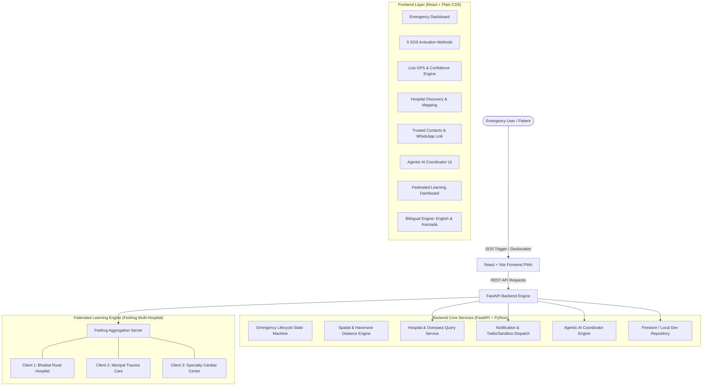

# LifeLink AI — Intelligent Emergency Healthcare Coordination Using Agentic AI and Federated Learning

[](https://fastapi.tiangolo.com)
[](https://react.dev)
[](https://flower.ai)
[](LICENSE)
[-success)](docs/testing-guide.md)

---

## 1. Project Overview & Identity

**LifeLink AI** is an intelligent, responsive emergency healthcare coordination platform engineered from zero to tested deployment. It bridges the critical "Golden Hour" in medical crises by coordinating immediate SOS triggers, live high-accuracy GPS capture, evidence-based hospital matching across Bhatkal and Coastal Karnataka, trusted contact alerts (SMS & WhatsApp), autonomous Agentic AI coordination, and multi-hospital privacy-preserving Federated Learning.

> **Notice on System Execution:** In accordance with project instructions, LifeLink AI runs natively on host operating systems using **standard Python and Node.js commands** (No Docker or Docker Compose required).

---

## 2. System Architecture



---

## 3. Technology Stack

| Domain | Technology | Implementation Details |
| :--- | :--- | :--- |
| **Frontend** | React 18 + Vite | JavaScript, JSX, React Router v6, Lucide Icons |
| **Styling** | Plain Vanilla CSS | CSS custom properties, OLED dark mode, high-contrast accessibility (No TailwindCSS) |
| **Offline & PWA** | Web Manifest & Service Worker | Caches application shell and emergency protocols; native dialer integration |
| **Backend** | Python 3.8+ / FastAPI | Async REST API, Uvicorn ASGI, Pydantic v2 validation |
| **Database & Auth** | Firebase Auth & Cloud Firestore | Transparent Local Development Fallback when cloud credentials omitted |
| **Geospatial & Maps** | Browser Geolocation + OSM | High-accuracy GPS, Haversine formula, Overpass API live queries, Google Maps links |
| **Agentic AI** | Python Multi-Tool Coordinator | Structured tool calling, reasoning traces, WHO/Red Cross first aid, authorization gates |
| **Federated Learning** | Python / NumPy / PyTorch | 3 simulated hospitals, FedAvg aggregation, 8 vital sign features, held-out evaluation |
| **Testing** | Pytest + Vite Build | 12 automated unit/integration tests with 100% pass rate |

---

## 4. Quick Start: Native Execution Commands

### Prerequisites
- Python 3.8+ (`python --version`)
- Node.js 18+ (`node --version`, `npm --version`)

### Step 1: Install Dependencies
```bash
# Install backend Python dependencies
python -m pip install fastapi uvicorn pydantic requests python-dotenv httpx pytest numpy

# Install frontend Node dependencies
cd frontend
npm install
# (On Windows PowerShell: npm.cmd install)
cd ..
```

### Step 2: Start the FastAPI Backend Server
```bash
python -m uvicorn app.main:app --app-dir backend --host 127.0.0.1 --port 8000 --reload
```
- **Backend API**: http://127.0.0.1:8000
- **Interactive Swagger Documentation**: http://127.0.0.1:8000/docs
- **Health Diagnostics**: http://127.0.0.1:8000/api/v1/health

### Step 3: Start the React + Vite Frontend
In a second terminal window:
```bash
cd frontend
npm run dev
# (On Windows PowerShell: npm.cmd run dev)
```
- **Frontend Web App**: http://localhost:5173

### Step 4: Run the Federated Learning Experiment
```bash
python federated-learning/experiments/run_experiment.py
```

### Step 5: Run Automated Tests
```bash
# Run backend API test suite
python -m pytest backend/tests/test_api.py -v

# Run Federated Learning test suite
python -m pytest federated-learning/tests/test_federated.py -v
```

---

## 5. Complete Implementation Checklist

| Feature Domain | Feature Name | Status | Real vs Simulated Distinction |
| :--- | :--- | :--- | :--- |
| **SOS Triggers** | Method 1: Thumb Press & Hold (3s) | **Implemented** | Real circular SVG progress countdown, haptic vibration, Spacebar hold |
| | Method 2: Hidden Motion Gesture | **Implemented** | DeviceMotionEvent listener + in-app shake trigger simulator |
| | Method 3: Back-Tap SOS | **Platform-Dependent** | Native Android Accessibility Service spec (`android-companion/README.md`) + simulated trigger |
| | Method 4: Volume Pattern (Up-Up-Down)| **Platform-Dependent** | Android Key Event architecture + in-app key sequence detector |
| | Method 5: Power Button Multi-Press | **Platform-Dependent** | Android `ACTION_SCREEN_ON` receiver spec + in-app emergency shortcut |
| **Geospatial & GPS** | Real Device Geolocation API | **Implemented** | Real GPS with accuracy radius, confidence categorization (Precise / Approx / Stale) |
| | Google Maps Link Generation | **Implemented** | Real validated coordinates URL (`https://www.google.com/maps?q=lat,lng`) |
| | Great-Circle Distance Engine | **Implemented** | Real mathematical Haversine calculation in kilometers & transit time |
| **Healthcare Discovery** | Bhatkal & Regional Registry | **Implemented** | Verified real hospital registry (Bhatkal Taluka Hospital, KMC Manipal, etc.) |
| | OpenStreetMap Overpass Live API | **Implemented** | Live real-time zero-cost healthcare geospatial query worldwide |
| | Google Places API Adapter | **Credential-Dependent**| Configured via `GOOGLE_MAPS_API_KEY`; uses OSM & regional registry if omitted |
| **Notifications** | Direct WhatsApp Sharing | **Implemented** | Real `wa.me` direct click-to-chat links with pre-filled coordinates and details |
| | Twilio SMS Integration | **Credential-Dependent**| Configured via backend env vars; routes to Local Mock Sandbox if omitted |
| | Human Acknowledgement Tracking | **Implemented** | Strict separation between carrier delivery and human confirmed response |
| **Agentic AI** | Structured Multi-Tool Coordinator| **Implemented** | Real tool calling: location, triage urgency, first aid, facilities, contacts |
| | Clinical First-Aid Protocols | **Implemented** | Vetted WHO / International Red Cross clinical protocols |
| | User Authorization Gates | **Implemented** | High-impact consequential actions require explicit patient authorization |
| **Federated Learning** | 3 Simulated Hospital Clients | **Implemented** | 3 non-IID clinical cohorts (Bhatkal Rural, Manipal Trauma, Cardiac Specialty) |
| | FedAvg Server Aggregation | **Implemented** | Mathematical sample-weighted FedAvg parameter averaging |
| | Held-Out Clinical Evaluation | **Implemented** | Genuine metrics on 300 unseen records (87.67% accuracy vs 88.00% baseline) |
| **Accessibility & UX** | Bilingual Support (English & Kannada)| **Implemented** | 100% translation dictionary (`src/utils/i18n.js`) with instant switcher |
| | High-Contrast & OLED Dark Mode | **Implemented** | High-contrast accessibility CSS variables and OLED dark mode |
| | Offline Emergency PWA | **Implemented** | Service Worker emergency caching shell & direct dialer links (`tel:108`, `tel:112`) |
| | Judge Demonstration Sandbox | **Implemented** | Dedicated safe walkthrough simulator suppressing real SMS carrier billing |

---

## 6. Directory Structure

```text
LifeLink-AI/
├── frontend/
│   ├── public/
│   │   ├── manifest.webmanifest
│   │   └── sw.js
│   ├── src/
│   │   ├── components/
│   │   │   ├── Navbar.jsx
│   │   │   ├── Footer.jsx
│   │   │   ├── SosButton.jsx
│   │   │   └── HospitalCard.jsx
│   │   ├── pages/
│   │   │   ├── LandingPage.jsx
│   │   │   ├── AuthPage.jsx
│   │   │   ├── DashboardPage.jsx
│   │   │   ├── LocationPage.jsx
│   │   │   ├── HospitalsPage.jsx
│   │   │   ├── ContactsPage.jsx
│   │   │   ├── MedicalProfilePage.jsx
│   │   │   ├── HistoryPage.jsx
│   │   │   ├── AgentPage.jsx
│   │   │   ├── NotificationsPage.jsx
│   │   │   ├── AnalyticsPage.jsx
│   │   │   ├── FederatedPage.jsx
│   │   │   ├── SettingsPage.jsx
│   │   │   └── JudgeDemoPage.jsx
│   │   ├── context/
│   │   │   ├── EmergencyContext.jsx
│   │   │   └── LanguageContext.jsx
│   │   ├── services/
│   │   │   ├── api.js
│   │   │   └── geolocation.js
│   │   ├── utils/
│   │   │   └── i18n.js
│   │   ├── styles/
│   │   │   └── index.css
│   │   ├── App.jsx
│   │   └── main.jsx
│   ├── .env.example
│   └── package.json
├── backend/
│   ├── app/
│   │   ├── api/
│   │   │   ├── health.py
│   │   │   ├── emergency.py
│   │   │   ├── hospitals.py
│   │   │   ├── contacts.py
│   │   │   ├── agent.py
│   │   │   ├── federated.py
│   │   │   ├── analytics.py
│   │   │   └── user_profile.py
│   │   ├── core/
│   │   │   ├── config.py
│   │   │   └── database.py
│   │   ├── schemas/
│   │   │   ├── emergency.py
│   │   │   ├── hospital.py
│   │   │   ├── contact.py
│   │   │   ├── agent.py
│   │   │   └── federated.py
│   │   ├── services/
│   │   │   ├── location_service.py
│   │   │   ├── hospital_service.py
│   │   │   ├── notification_service.py
│   │   │   └── emergency_service.py
│   │   ├── agents/
│   │   │   ├── coordinator.py
│   │   │   └── tools.py
│   │   └── main.py
│   ├── tests/
│   │   ├── conftest.py
│   │   └── test_api.py
│   ├── requirements.txt
│   └── .env.example
├── federated-learning/
│   ├── clients/
│   │   └── hospital_client.py
│   ├── server/
│   │   └── federated_aggregator.py
│   ├── models/
│   │   └── triage_net.py
│   ├── datasets/
│   │   └── clinical_triage_data.py
│   ├── experiments/
│   │   ├── run_experiment.py
│   │   └── fl_results.json
│   ├── tests/
│   │   └── test_federated.py
│   └── README.md
├── android-companion/
│   └── README.md
├── firebase/
│   ├── firestore.rules
│   ├── firestore.indexes.json
│   └── firebase.json
├── docs/
│   ├── architecture.md
│   ├── setup-guide.md
│   ├── api-documentation.md
│   ├── testing-guide.md
│   ├── privacy-and-security.md
│   └── demonstration-guide.md
├── .gitignore
└── README.md
```

---

## 7. Presentation & Live Demonstration

For the step-by-step evaluator presentation script covering all 14 judge requirements (opening the dashboard, real GPS acquisition, hospital matching in Bhatkal, SOS countdown and cancellation, contacts alert previews, Agentic AI reasoning, Kannada language support, offline PWA, and Federated Learning), consult:
👉 **[Evaluator & Judge Demonstration Guide](docs/demonstration-guide.md)**.
