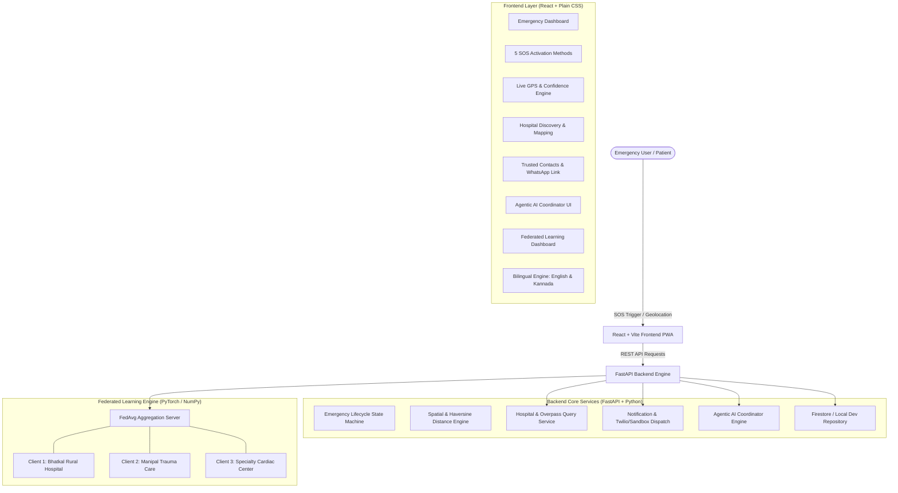

# LifeLink AI — System Architecture Specification

## 1. High-Level Architecture

LifeLink AI is an intelligent emergency healthcare coordination platform integrating real GPS location processing, evidence-based hospital discovery, multi-channel emergency alert notifications, explainable Agentic AI, and privacy-preserving Federated Learning.

---

## 2. Component Breakdown

### A. Frontend Layer
- **Framework**: React 18, Vite, React Router v6.
- **Styling**: Vanilla Plain CSS design system using CSS custom properties (`index.css`), high-contrast accessibility mode, and OLED dark mode.
- **PWA Support**: Offline Service Worker (`sw.js`) and Web Manifest (`manifest.webmanifest`) caching shell and emergency first aid.
- **Multilingual**: Central dictionary (`src/utils/i18n.js`) providing 100% translation in English and Kannada (ಕನ್ನಡ).

### B. Backend Layer
- **Framework**: Python 3.8+, FastAPI, Uvicorn ASGI server.
- **Data Validation**: Pydantic v2 schemas for all requests and responses.
- **State Machine**: Tracks emergency states: `created` ➔ `processing` ➔ `notification_pending` ➔ `notification_sent` ➔ `notification_delivered` ➔ `resolved` / `cancelled`.
- **Deduplication**: 60-second time window and idempotency key matching to block double triggers.

### C. Geospatial & Hospital Intelligence
- **GPS Coordinates**: Extracted via browser Geolocation API with `enableHighAccuracy: true`.
- **Distance Calculation**: Exact great-circle Haversine formula yielding verified kilometers and transit time estimates.
- **Data Providers**:
  - OpenStreetMap Overpass API for live global healthcare nodes.
  - Verified Regional Healthcare Directory for Bhatkal, Uttara Kannada, Kundapura, Udupi, and Karwar.
  - Google Places API adapter when configured.

### D. Agentic AI Coordinator
- **Architecture**: Structured tool-execution coordinator with validated inputs/outputs.
- **Tools**: `get_emergency_location`, `assess_triage_urgency`, `lookup_first_aid_protocols`, `search_nearby_hospitals`, `verify_trusted_contacts`.
- **Safety Gate**: Consequential actions (mass SMS broadcasts, external hospital notification) require explicit user authorization.

### E. Federated Learning
- **Task**: Patient Emergency Triage Risk Classification (8 vital sign features).
- **Architecture**: Multi-Layer Perceptron (8 ➔ 16 ➔ 1).
- **Algorithm**: Federated Averaging (FedAvg). Raw patient vital signs never leave client boundaries.
