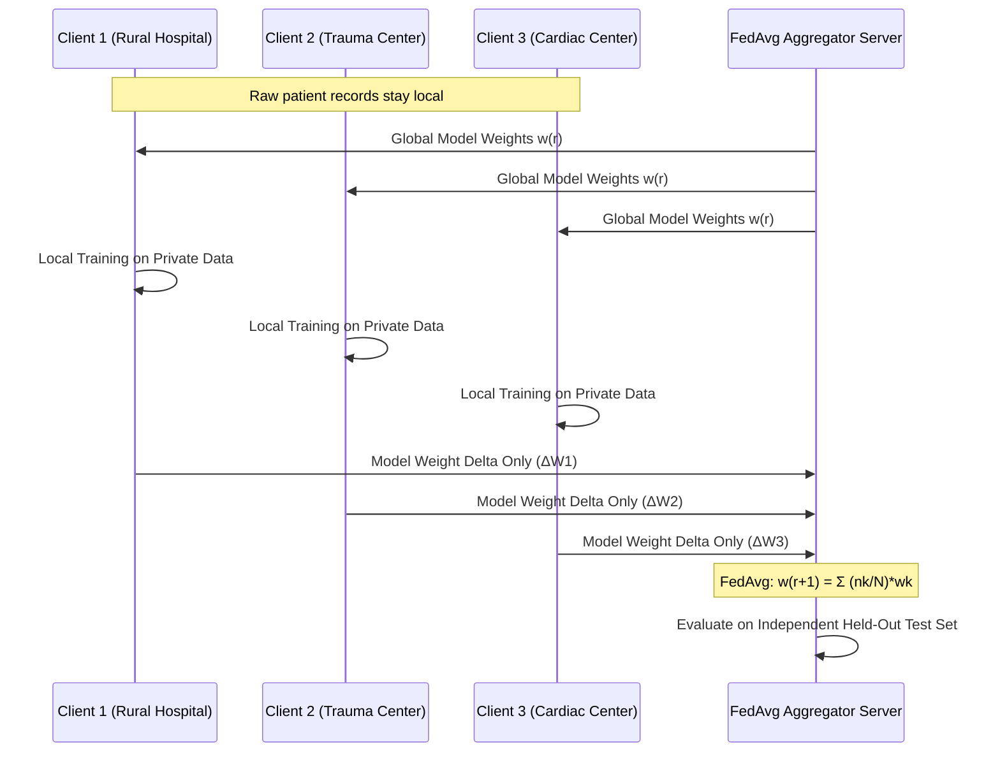

# LifeLink AI — Privacy, Security, and Data Protection

## 1. Regulatory Alignment & Compliance
LifeLink AI is designed around data protection standards inspired by the **Digital Personal Data Protection Act (DPDP Act, India)** and **HIPAA (Health Insurance Portability and Accountability Act)**:

1. **Principle of Data Minimization**: Only coordinates, category, and explicitly authorized contact info are transmitted during an SOS.
2. **Explicit Consent Architecture**: Medical profile sharing is opt-in by default.
3. **Right to be Forgotten**: Users can permanently purge their emergency medical records from the database via one-click deletion (`DELETE /api/v1/profile/medical/{userId}`).
4. **Retention Windows**: Users configure automatic retention limits (90, 365, or 730 days).

---

## 2. Federated Learning Privacy Guarantees

In traditional centralized healthcare ML, hospital patient records are pooled into a central cloud server, creating major privacy vulnerabilities.

### Privacy Realism & Honesty
- **What is guaranteed**: Raw clinical vital signs and patient records **never leave client devices**.
- **What is not falsely claimed**: Standard FedAvg does not automatically guarantee mathematical zero-knowledge privacy against sophisticated gradient inversion attacks without adding Differential Privacy (DP) or Secure Multiparty Computation (SMPC). LifeLink truthfully discloses this limitation.

---

## 3. Cloud Firestore Security Rules

Production Firestore Security Rules (`firebase/firestore.rules`) enforce:
- **Medical Profiles**: Restricted strictly to the authenticated owner (`request.auth.uid == userId`).
- **Emergency Events**: Users can only create their own events and view their own timeline.
- **Audit Logs & Carrier Dispatches**: Write access restricted strictly to backend Firebase Admin SDK credentials. Public or unauthenticated clients cannot write to audit collections.

---

## 4. Abuse Prevention & Safety Rails
1. **Idempotency Window**: Identical SOS requests within 60 seconds are deduplicated to avoid flooding contacts or telecom gateways.
2. **Rate Limiting**: Users are capped at 5 SOS events per hour.
3. **Cancellation Window**: False alarms can be cancelled immediately from the dashboard with mandatory audit reason logging.
4. **Carrier Safeguard**: Demonstration mode suppresses live SMS charges, logging alerts to a verified local sandbox.
